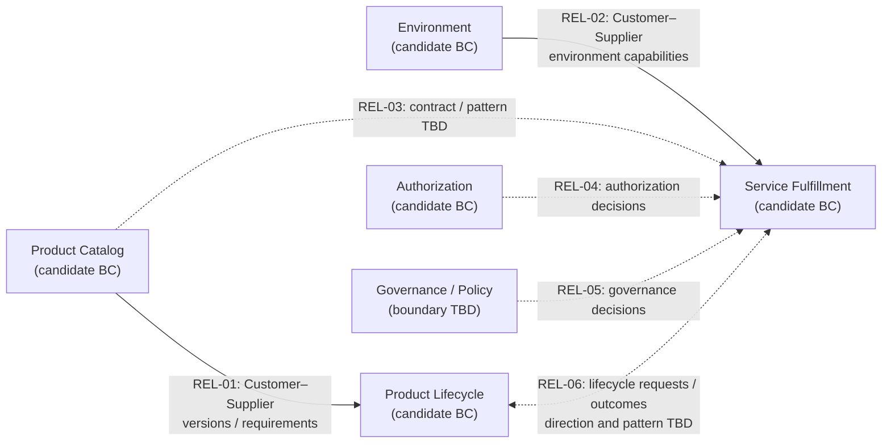

# PlatformAI — Context Map

**Version:** 0.1  
**Status:** Proposed — Under Evaluation  
**Scope:** Product installation and related platform capabilities  
**Related:** [Domain Architecture v0.2](./domain-architecture.md)

## 1. Purpose

This document captures candidate Bounded Context relationships for PlatformAI, their upstream/downstream dependencies, proposed DDD Context Mapping patterns, integration contracts, trade-offs, and unresolved ownership questions.

It is an architectural hypothesis for review, **not** an approved final context map. Bounded Contexts are semantic and decision-making boundaries, not necessarily independently deployed microservices.

## 2. Design principles

1. **Domain ownership before implementation:** assign business rules and invariants to a domain boundary before selecting an engine, API, agent, or service.
2. **Orchestration is not ownership:** Service Fulfillment coordinates requests; it does not automatically own Product Instance transitions, compatibility requirements, or authorization rules.
3. **Protect models across boundaries:** consumers should not depend on upstream internal entities. Use published contracts and translation where justified.
4. **Evidence is not authority:** a readiness assessment or policy evaluation does not automatically authorize a lifecycle transition or deployment.
5. **Avoid premature consolidation:** a shared API, policy engine, or workflow engine does not imply a shared Bounded Context.
6. **State uncertainty explicitly:** candidate relationships and unresolved rules are not architectural decisions.

## 3. Candidate Bounded Contexts

| Context | Candidate ownership | Boundary / caveat |
| --- | --- | --- |
| **Product Catalog** | Product definitions, versions, dependencies, published installation requirements, add-on definitions | Does not own runtime Product Instance state |
| **Product Lifecycle** | Product Instances, their lifecycle invariants and allowed transitions, lifecycle operations | Proposed separation from Product Catalog; readiness criteria ownership remains open |
| **Environment** | Environment types, profiles, flavours, instances, capabilities and environment-specific constraints | Ownership of cross-product compatibility decisions remains open |
| **Service Fulfillment** | Processing and coordinating service requests, prerequisites, approval gates and outcomes | Does not inherit rules owned by contexts it coordinates |
| **Authorization** | Subject/action/resource permissions and access decisions | Organizational governance constraints may need a distinct context |
| **Governance / Policy Management** | Candidate ownership for organization-wide restrictions and guardrails | **Not yet approved as a separate Bounded Context** |

Additional domains recognized in Domain Architecture v0.2 — Identity, Service Marketplace, Service Domain, Customer Entitlement, Platform Engines and Automation/Execution — are **not exhaustively mapped** here. Customer Entitlement remains an architectural concern, not an approved independent context.

## 4. Candidate context map

**Reading rule:** Solid arrows indicate proposed upstream-to-downstream contract dependencies. Dashed arrows indicate relationships requiring further validation; they are **not** asserted upstream/downstream directions. These arrows are **not** network call directions. The diagram is scoped to installation-related interactions, not a complete enterprise map.

## 5. Relationship register

### REL-01 — Product Catalog → Product Lifecycle

- **Upstream:** Product Catalog.
- **Downstream:** Product Lifecycle.
- **Proposed relationship:** **Customer–Supplier**: Lifecycle requests version/upgrade information; Catalog collaborates on the published contract.
- **Integration candidates:** Versioned Open Host Service; Published Language for product version and supported upgrade paths; optional downstream Anti-Corruption Layer if semantic translation is needed.
- **Reason:** Product Lifecycle depends on published product definitions but must preserve its own instance model and invariants.
- **Trade-off:** Contract evolution requires coordination, versioning, compatibility checks and deprecation discipline.
- **Status:** Proposed.

### REL-02 — Environment → Service Fulfillment

- **Upstream:** Environment.
- **Downstream:** Service Fulfillment.
- **Proposed relationship:** **Customer–Supplier** for environment capabilities and constraints, assuming Environment collaborates on the contract.
- **Integration candidates:** Versioned capability snapshot or query contract; explicit provenance/freshness where decisions depend on live conditions.
- **Important distinction:** Environment owns its facts and environment-specific rules; this does **not** automatically grant ownership of the complete product-environment compatibility decision.
- **Status:** Proposed.

### REL-03 — Product Catalog and Service Fulfillment

- **Need:** Fulfillment may consume published installation requirements and product metadata.
- **Direction/pattern:** Candidate Catalog upstream; validate the exact information consumed, contract and team relationship.
- **Status:** Open.

### REL-04 — Authorization and Service Fulfillment

- **Need:** Fulfillment must enforce permission decisions before protected actions.
- **Ownership:** Authorization owns subject/action/resource permission semantics; Fulfillment enforces relevant decisions at its boundary.
- **Direction/pattern:** To be characterized based on the actual published decision contract and collaboration.
- **Status:** Open.

### REL-05 — Governance / Policy and Service Fulfillment

- **Need:** Organization-wide constraints may prohibit technically compatible installations.
- **Example:** A product is technically compatible with GKE, but an organizational policy prohibits it in a critical environment.
- **Decision separation:** Compatibility = `COMPATIBLE`; governance = `DENIED`; Fulfillment must not execute the installation.
- **Boundary:** Determine whether governance belongs within an expanded Authorization Context or an independently owned context.
- **Status:** Open; candidate context only.

### REL-06 — Service Fulfillment and Product Lifecycle

- **Fulfillment:** Coordinates installation requests, prerequisites, approvals and process outcomes.
- **Lifecycle:** Owns Product Instance state, invariants and allowed transitions.
- **Interaction candidate:** Fulfillment requests a lifecycle operation and consumes its outcome; the exact upstream/downstream contract relationship requires further analysis.
- **Risk:** Moving Product Instance transition rules into Fulfillment creates semantic coupling and risks a God Component.
- **Status:** Ownership split proposed; Context Mapping pattern open.

## 6. Cross-context decision example — Product installation

1. A requester submits `RequestProductInstallation` through the platform.
2. Fulfillment obtains authorization and applicable governance decisions.
3. Product requirements and environment capabilities are collected from their owning contexts.
4. A designated domain capability evaluates product-environment compatibility (**ownership unresolved**).
5. Fulfillment applies request-processing rules: proceed, reject, suspend for approval, or wait for prerequisite remediation.
6. Fulfillment requests the appropriate Product Lifecycle operation.
7. Product Lifecycle protects Product Instance invariants and records allowed state changes.
8. Readiness evidence is evaluated; Product Lifecycle determines whether the assessment is applicable to the current instance and its state.
9. Fulfillment coordinates the overall request outcome and reporting.

The sequence is conceptual. It does not prescribe synchronous APIs, distributed transactions, separate microservices, or a specific workflow engine.

### Readiness versus lifecycle

A `NOT_READY` evaluation is an assessment, **not** automatically a lifecycle command. Applicability may depend on instance generation, evidence freshness, concurrency, and permitted transitions. `UPGRADING` and `NOT_READY` may describe different dimensions (lifecycle versus operational readiness); this modeling hypothesis remains open for subsequent domain-model analysis.

### Policy engine versus policy ownership

A shared engine such as OPA may execute policies owned by different domains. Centralized execution does not transfer ownership of all rules to the engine. Availability, scaling and failure isolation of policy evaluation are separate deployment concerns.

## 7. Pattern selection notes

- **Customer–Supplier:** Proposed for REL-01 and REL-02 because the upstream owners collaborate on downstream contract needs.
- **Open Host Service / Published Language:** Candidate contract mechanisms, especially where several consumers need stable, documented interfaces.
- **Anti-Corruption Layer:** Use selectively to protect downstream domain semantics; do not turn adapters into owners of readiness or lifecycle rules.
- **Partnership:** Appropriate when teams coordinate ongoing evolution while retaining independent models; not automatically required for every integration.
- **Shared Kernel:** No current evidence justifies a jointly governed shared domain model. Avoid sharing internal entities merely because fields or identifiers overlap.
- **Conformist:** No current relationship is deliberately classified as Conformist.
- **Separate Ways:** Consider when an integration's costs exceed its domain benefits.

## 8. Trade-offs and risks

| Risk | Consequence | Mitigation candidate |
| --- | --- | --- |
| Shared internal product models | Semantic coupling and coordinated releases | Published contracts; selective translation |
| Business rules embedded in workflow orchestration | God Component and change amplification | Explicit domain ownership and lifecycle commands |
| All policies owned by a technical engine | Centralized domain decision bottleneck | Domain-owned policy definitions and governance |
| Single remote policy evaluator | Potential runtime bottleneck / failure point | Replication, local evaluation, versioned policy distribution |
| Stale compatibility or readiness evidence | Incorrect request or state decisions | Evidence freshness, generation checks, concurrency safeguards |
| Premature BC proliferation | Excessive complexity and integration overhead | Validate independent language, invariants, ownership and change cadence |

## 9. Open architectural decisions

- **OD-01:** Which context owns the final product-environment compatibility decision, distinct from product requirements and environment facts?
- **OD-02:** Should Governance / Policy Management be a separate Bounded Context or part of Authorization?
- **OD-03:** What is the exact contract and relationship pattern between Service Fulfillment and Product Lifecycle?
- **OD-04:** Which context owns product-specific readiness criteria, readiness assessments, and Product Instance readiness transitions?
- **OD-05:** Should lifecycle status and readiness status be separate state dimensions?
- **OD-06:** How should customer entitlement checks participate without conflating contractual eligibility with user authorization?
- **OD-07:** Which contracts should be synchronous queries, asynchronous events, or both, and what are their consistency expectations?
- **OD-08:** Which integration contracts warrant ACLs, OHS and Published Languages based on real consumers?
- **OD-09:** Are the candidate contexts sufficiently independent to justify these boundaries in implementation?

## 10. Review and evolution

**Proposed review criteria:** verify domain ownership with stakeholders, walk through installation/upgrade/failure scenarios, test semantic boundaries, record contract evolution requirements, and update the relationship register.

This document contributes to the ongoing consolidation of Domain Architecture v0.3 (issue #18), but does **not** itself finalize that architecture or close the issue.

**Next architecture review focus:** Refine Product Instance invariants, aggregate consistency boundaries, and the lifecycle/readiness state model.
