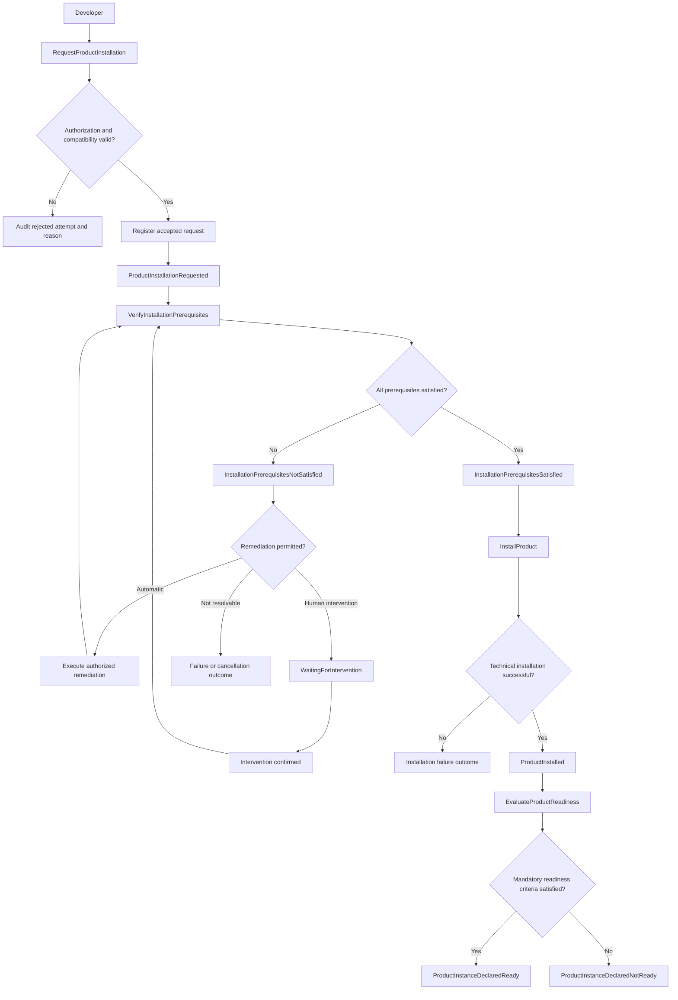

# Product Installation — Domain Discovery

**Version:** v0.1  
**Status:** Discovery / Proposed  
**Project:** PlatformAI  
**Related Issue:** [#18 — Consolidate Domain Architecture v0.3](https://github.com/Blanchekahou/platform-ai/issues/18)

## 1. Purpose

This document captures the initial domain discovery findings for the **Install Product** capability in PlatformAI.

It documents business scenarios, actors, commands, candidate domain events, business rules, alternative flows, and architectural questions identified during the PlatformAI Architecture Academy.

The objective is to establish a shared understanding of product installation behavior before formalizing domain ownership, consistency boundaries, and implementation decisions.

This document complements:

- [Domain Architecture v0.2](../architecture/domain-architecture.md)
- [Service Catalog v0.1](../catalog/service-catalog.md)

It does not replace these documents or introduce finalized implementation contracts.

## 2. Domain Context

PlatformAI provides reusable self-service capabilities for requesting and managing platform resources.

The existing Service Catalog defines **Install Product** as an atomic service.

The current Domain Architecture distinguishes:

- **Product Definition:** Describes a deployable product, its configuration, dependencies, and constraints.
- **Product Instance:** Represents an installed realization of a product within an Environment Instance.
- **Environment Instance:** Represents a provisioned environment in which products operate.
- **Service Orchestration:** Coordinates requested platform operations without owning every underlying domain state.
- **Platform Engines:** Provide reusable capabilities for workflow coordination, lifecycle operations, policy evaluation, and execution support.

Product installation may involve authorization, entitlement where applicable, compatibility checks, prerequisite verification, remediation, installation execution, and operational readiness validation.

Successful technical execution must not automatically imply Product Instance readiness.

## 3. Business Scenario

A developer requests the installation of Product A into an authorized development environment.

PlatformAI must:

1. Validate the requester's authorization.
2. Validate product and environment compatibility.
3. Register the accepted installation request.
4. Verify mandatory installation prerequisites.
5. Coordinate authorized remediation where necessary.
6. Execute the installation.
7. Evaluate Product Instance operational readiness.
8. Report the resulting outcome.

Rejected attempts must remain auditable without being registered as accepted installation requests.

## 4. Actors

| Actor | Responsibility |
|---|---|
| Developer | Initiates the installation request |
| Platform Engineer | May perform or approve operational interventions |
| PlatformAI | Coordinates validation, execution, and outcome reporting |

These actors represent scenario participants, not authorization roles.

## 5. Commands and Candidate Domain Events

Commands express an intention to perform an operation.

Domain events represent meaningful business facts that have occurred.

| Command | Candidate Domain Event |
|---|---|
| `RequestProductInstallation` | `ProductInstallationRequested` |
| `VerifyInstallationPrerequisites` | `InstallationPrerequisitesSatisfied` |
| `VerifyInstallationPrerequisites` | `InstallationPrerequisitesNotSatisfied` |
| `InstallProduct` | `ProductInstalled` |
| `EvaluateProductReadiness` | `ProductInstanceDeclaredReady` |
| `EvaluateProductReadiness` | `ProductInstanceDeclaredNotReady` |

### Event Semantics

`ProductInstallationRequested` means that an installation request has passed the required initial validations and has been registered for processing.

It must not be emitted for rejected attempts.

`ProductInstalled` represents successful technical installation, not necessarily operational readiness.

`ProductInstanceDeclaredReady` means that all mandatory operational readiness criteria have been satisfied.

`ProductInstanceDeclaredNotReady` indicates that the instance has not satisfied the required readiness criteria.

These names are discovery candidates and must be reviewed before becoming implementation-level event contracts.

## 6. Business Rules

### BR-01 — Authorization

A product installation request must satisfy the required authorization rules for the requester, target product, and target environment.

### BR-02 — Compatibility

A product may be installed only into an environment satisfying its applicable compatibility constraints.

### BR-03 — Mandatory Prerequisites

Installation execution must not begin while mandatory prerequisites remain unsatisfied.

### BR-04 — Governed Remediation

PlatformAI may automatically remediate missing prerequisites only when the applicable permissions and policies authorize the corrective actions.

### BR-05 — Prerequisite Revalidation

Following remediation or human intervention, all applicable mandatory prerequisites must be verified again before installation proceeds.

### BR-06 — Operational Readiness

A Product Instance may be declared Ready only when all mandatory operational readiness criteria have been satisfied.

### BR-07 — Request Registration and Rejection Audit

A product installation request must pass authorization and compatibility validation before being registered as an accepted installation request.

The `ProductInstallationRequested` domain event is emitted only after the request has been accepted and registered.

Rejected attempts must be recorded for audit purposes, including their rejection reasons and relevant request context, subject to security and retention policies.

Rejected attempts must not produce `ProductInstallationRequested`.

Audit recording does not, by itself, require introducing a separate domain event.

### BR-08 — Prerequisite Remediation and Workflow Suspension

An accepted product installation request must not proceed to installation while mandatory prerequisites remain unsatisfied.

When a missing prerequisite can be remediated through an authorized automated action, PlatformAI may perform that remediation.

When human intervention is required, the workflow may enter a `WaitingForIntervention` state rather than being automatically rejected.

Once the intervention is confirmed, mandatory prerequisites must be revalidated before installation resumes.

## 7. Happy Path

1. A developer submits `RequestProductInstallation`.
2. Authorization and compatibility are validated.
3. The installation request is accepted and registered.
4. `ProductInstallationRequested` occurs.
5. `VerifyInstallationPrerequisites` is initiated.
6. All mandatory prerequisites are satisfied.
7. `InstallationPrerequisitesSatisfied` occurs.
8. `InstallProduct` is initiated.
9. Technical installation succeeds.
10. `ProductInstalled` occurs.
11. `EvaluateProductReadiness` is initiated.
12. Mandatory readiness criteria are satisfied.
13. `ProductInstanceDeclaredReady` occurs.

## 8. Event Storming — Conceptual Flow

This diagram represents the discovered business flow.

It does not prescribe software component boundaries, event transport mechanisms, persistence strategies, or synchronous execution.

## 9. Alternative Scenarios

### AS-01 — Unauthorized Installation Request

The developer does not have permission to install the selected product into the target environment.

**Outcome:**

- The request is rejected.
- The rejected attempt and reason are recorded for audit.
- No accepted installation request is registered.
- `ProductInstallationRequested` is not emitted.

### AS-02 — Incompatible Environment

The selected product is not compatible with the target environment.

**Outcome:**

- The request is rejected.
- The compatibility failure is recorded for audit.
- Installation does not proceed.

### AS-03 — Automatically Remediable Prerequisite

A required Kubernetes namespace does not exist, but its creation is authorized.

**Outcome:**

- PlatformAI coordinates namespace creation.
- Mandatory prerequisites are verified again.
- Installation proceeds only if all required conditions are satisfied.

### AS-04 — Human Intervention Required

A required database secret is missing, and its creation requires human intervention.

**Outcome:**

- The accepted installation workflow enters `WaitingForIntervention`.
- The required intervention is identified.
- Once intervention is confirmed, prerequisite verification is repeated.
- Installation remains blocked until all mandatory prerequisites are satisfied.

### AS-05 — Installation Succeeds but Product Is Not Ready

Product installation completes successfully, but the application cannot connect to its database.

**Outcome:**

- Technical installation success is recorded.
- Product readiness evaluation fails.
- The Product Instance is not declared Ready.
- The overall workflow outcome remains governed by its completion criteria.

### AS-06 — Workflow Interrupted During Intervention

A workflow is suspended while waiting for human intervention. The intervention is completed, but workflow execution has been interrupted.

**Outcome:**

- The Workflow Engine is responsible for coordinating resumption.
- Prerequisite verification is repeated.
- The Product Domain retains responsibility for product-specific business rules and state.
- The workflow must not bypass authorization or applicable policies.

## 10. Architectural Discovery Decisions

### DD-01 — Rejected Request Audit

**Decision:**

Validate authorization and compatibility before registering an accepted installation request.

Rejected attempts must remain auditable, including their rejection reasons.

`ProductInstallationRequested` is reserved for accepted and registered requests.

**Rationale:**

Preserves clear domain event semantics while maintaining traceability of rejected attempts.

**Status:** Proposed — reviewed during domain discovery.

### DD-02 — Prerequisite Remediation and Intervention

**Decision:**

Distinguish between automatically remediable prerequisites, prerequisites requiring human intervention, and conditions that cannot be resolved within the current workflow.

The installation workflow must not proceed until mandatory prerequisites have been revalidated.

**Rationale:**

Avoids premature rejection while preserving safety and correctness.

**Status:** Proposed — reviewed during domain discovery.

### DD-03 — Workflow Suspension and Resumption

**Decision:**

The Workflow Engine coordinates the suspension and resumption of accepted product installation workflows.

The Workflow Engine must not independently override Product Domain rules, readiness criteria, authorization, or policy decisions.

**Rationale:**

Separates workflow coordination from product-specific domain responsibilities.

**Status:** Proposed — pending Domain Architecture v0.3 consolidation.

## 11. Domain Discoveries

The initial discovery identifies the following distinctions:

- Authorization is not compatibility.
- Request rejection is not workflow failure.
- Audit records are not necessarily domain events.
- Prerequisite verification is not remediation.
- Installation execution success is not Product Instance readiness.
- Workflow state is not Product Instance state.
- Workflow coordination is not ownership of product business rules.
- Infrastructure signals are not automatically domain events.

These distinctions provide input to future domain modeling and architecture decisions.

## 12. Open Questions

1. Which component owns rejected-attempt audit records and their retention policy?
2. Which domain owns accepted installation request state?
3. What are the authoritative readiness criteria for each product?
4. Which domain owns Product Instance readiness evaluation and state?
5. How should readiness changes after initial installation be represented?
6. What are the workflow completion criteria when installation succeeds but readiness fails?
7. How should retries, cancellation, timeouts, and compensation be governed?
8. Which candidate events should become stable domain event contracts?
9. How should intervention completion be authenticated and correlated with the waiting workflow?
10. How should duplicate requests and concurrent installation attempts be handled?

## 13. Alignment with Domain Architecture v0.3

These findings contribute to [Issue #18](https://github.com/Blanchekahou/platform-ai/issues/18), particularly:

- Domain ownership and lifecycle.
- Workflow orchestration and state management.
- Commands and domain events.
- Authorization, policy, and execution authority.
- Product readiness and validation.
- Audit traceability.

The findings are inputs to architectural consolidation, not replacements for existing domain definitions.

## 14. Out of Scope

This discovery does not define:

- Final bounded context boundaries.
- Entities, aggregates, or repositories.
- Database schemas.
- APIs and event payloads.
- Messaging infrastructure or delivery guarantees.
- Kubernetes, Helm, or GitOps implementation details.
- AI agent execution behavior.

These concerns will be addressed during subsequent architecture work.

---

**Next Step:** Review and merge the discovery document, then use its findings to inform Domain Architecture v0.3 and subsequent DDD modeling exercises.